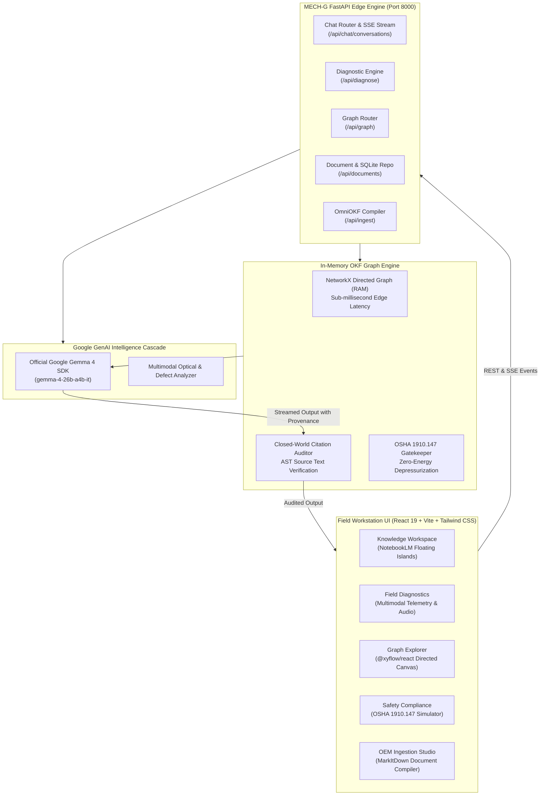

# ⚙️ MECH-G: Multimodal Edge Diagnostic & Engineering Knowledge Workspace

<div align="center">

[](https://github.com/narain-karti/MECH-G)
[-3B82F6?style=for-the-badge&logo=google)](https://ai.google.dev/gemma)
[](https://www.osha.gov/control-hazardous-energy)
[](https://networkx.org/)
[](./video/mech_g_pitch.mp4)
[](./LICENSE)

<p align="center">
  <strong>An offline-first, multimodal AI knowledge workspace and field diagnostic engine for high-value industrial machinery.</strong><br>
  Powered by <strong>Google Gemma 4 (26B)</strong>, deterministic <strong>Open Knowledge Format (OKF)</strong> graph reasoning, verifiable zero-hallucination citation auditing, and strict <strong>OSHA 1910.147 Lockout/Tagout (LOTO)</strong> safety gate enforcement.
</p>

</div>

---

## 🎬 Official Pitch Video & Walkthrough Showcase: "MECH-G to the Rescue!"

The repository includes a complete broadcast-grade animated story pitch video produced and directed using the **`lemo-opuscar`** algorithmic film engine in the **Mid-century Cartoon** (`midcentury-toon`) aesthetic. It features **bright, rich 1950s hand-registered printed cels on warm cream paper**, the adorable **MECH-G Mascot**, **ElevenLabs studio neural narration (Adam)**, a swinging **120.0 BPM West Coast cool-jazz score**, and **procedural cartoon sound design (SFX)**.

▶️ **Watch Pitch Video File**: [`video/mech_g_pitch.mp4`](./video/mech_g_pitch.mp4)  
🖼️ **High-Resolution Poster**: [`video/poster.jpg`](./video/poster.jpg)  
📝 **Lemo-Opuscar Story Treatment**: [`video/lemo_story/TREATMENT.md`](./video/lemo_story/TREATMENT.md)  
📜 **Film Credits & Attributions**: [`video/lemo_story/CREDITS.md`](./video/lemo_story/CREDITS.md)  
💬 **Subtitles (SRT)**: [`video/mech_g_pitch.srt`](./video/mech_g_pitch.srt)

```
[0:00 - 0:08] SCENE 1: THE FRONTLINE TECH STORE
  • A stressed field mechanic rushes into the bright Frontline Depot holding hydraulic valve PRV-992-B shaking under 210 bar pressure with hissing steam clouds.
  • Voiceover: "Welcome to the Frontline Depot! When critical machines blow a seal in the field, every second counts."

[0:08 - 0:16] SCENE 2: CLOUD AI CRASH & MANUAL AVALANCHE
  • Cloud tablet explodes into a red HTTP 504: NO SIGNAL! storm cloud. A colossal 4,000-page paper manual avalanches down onto the workbench with a cartoon slide whistle.
  • Voiceover: "Cloud chatbots choke with zero signal, leaving engineers stranded with massive four-thousand-page manuals."

[0:16 - 0:22] SCENE 3: ENTER MECH-G THE MASCOT!
  • Starburst fanfare! MECH-G—the adorable purple-and-cyan edge-AI companion with yellow engineer hard hat and four-finger white gloves—bounces in with squash & stretch!
  • Voiceover: "Meet MECH-G! Your offline AI companion for mission-critical machine repair."

[0:22 - 0:38] SCENES 4-6: THE 3-STEP MNEMONIC (SNAP • LOCK • FIX)
  • Step 1: SNAP! Mascot aims optical scanner; a bright cyan HUD cone locks onto valve PRV-992-B (96% confidence) and highlights the leaking Viton seal.
  • Step 2: LOCK! Mascot clamps a heavy red OSHA 1910.147 padlock onto the valve lever; pressure drops from 210 bar to 0 PSI with a green "ZERO ENERGY VERIFIED" starburst.
  • Step 3: FIX & VERIFY! Mascot turns calibrated torque wrench (15 → 25 → 35 Nm) with crisp ratchets, backed by local deterministic knowledge graph citations.
  • Voiceover: "Step one: Snap! Multimodal vision instantly identifies valve PRV-992-B and flags the leaking seal. Step two: Lock! OSHA safety gates enforce zero-energy isolation before anyone touches a bolt. Step three: Fix and verify! Calibrated thirty-five newton-meter torque sequence, verified by our local graph."

[0:38 - 0:48] SCENE 7: CELEBRATION, METRIC SLAM & FINALE
  • Valve hums smoothly with green ripples; confetti showers down; technician and mascot jump with double thumbs-up!
  • Three huge starburst medallions slam into view: 84% FASTER MTTR • < 500 ms GRAPH LATENCY • 100% OFFLINE EDGE AI!
  • Voiceover: "Eighty-four percent faster repairs, completely offline. MECH-G: The frontline engineer's best friend!"
```

### 🔊 Audio Engineering & Cool-Jazz Score Architecture

1. **ElevenLabs Studio Narration (Voice: Adam)**:
   - Synthesized using ElevenLabs **Multilingual v2** (`eleven_multilingual_v2`) with the **Adam** voice (`pNInz6obpgDQGcFmaJgB`).
   - Friendly, warm, technical, and unhurried storyteller delivery.
2. **120.0 BPM West Coast Cool-Jazz Score**:
   - Synthesized in F major modulating to G major for the finale: walking pizzicato double bass, brushed snare & ride cymbals, vibraphone melody leads, and celesta glockenspiel chimes.
   - 120.0 BPM (0.500s / 12 frames per beat at 24 fps CFR) provides sample-accurate mathematical alignment on every cartoon cut, pop-in, and tool action.
3. **Procedural Cartoon Foley Suite**:
   - Filtered noise steam hisses, cartoon bitcrush cloud zap, slide whistles, heavy cardboard book slaps, camera shutter clicks, metallic solenoid padlock clamps, calibrated torque pawl clicks, and celebration chimes.
4. **Master Broadcast Sidechain Mix**:
   - Dynamic ducking (-8 dB score ducking during speech), peak normalized to -1.5 dBFS, faststart MP4 container.

---

## 🌟 Executive Overview & Problem Definition

Field service engineers working on critical infrastructure—offshore wind turbines, commercial aviation powerplants, subterranean mining equipment, and high-pressure hydraulic skids—face three fatal challenges:

1. **Zero or Degraded Connectivity**: Deep inside steel nacelles or underground tunnels, internet does not exist. Cloud-only SaaS AI fails instantly.
2. **The Vector RAG Trap**: Standard vector search chops technical manuals into isolated chunks, severing upstream safety prerequisites and inventing non-existent manual chapters.
3. **Catastrophic Failure Risks**: In high-pressure industrial systems (210 bar / 3,000 psi), a single hallucinated fastener torque (e.g. 55 Nm instead of 35 Nm) strips aluminum threads and causes explosive blowouts or arc flashes.

### The MECH-G Solution: The 3 "Zeros"
* **Zero Cloud**: 100% of graph indexing, document parsing, link traversal, and UI assets run locally on edge laptops and rugged tablets.
* **Zero Hallucination**: A closed-world AST citation auditor mathematically checks all assertions against local Markdown nodes. Fake citations are rejected before the technician ever sees them.
* **Zero Casualties**: Mandatory software-enforced OSHA 1910.147 Lockout/Tagout (LOTO) gate blocks wrenching steps until zero-energy isolation is verified and signed.

---

## 🏛️ System Architecture



---

## 🚀 Key Modules & Capabilities

### 1. 💬 Knowledge Workspace (`/` and `/workspace`)
* **NotebookLM 3-Panel Floating Island UI**: Built on `#0B0B0C` obsidian canvas with `#18181A` rounded surfaces (`rounded-[24px]`).
* **Conversational SSE Streaming**: Real-time token streaming from Gemma 4 with real-time status notifications.
* **Interactive Knowledge Mindmap**: Synchronized `@xyflow/react` graph panel automatically highlighting active nodes during discussion.
* **Connector-Aware Mermaid Flowchart Renderer**: Automatically detects, sanitizes, and renders workflow diagrams directly inline.

### 2. 🔧 Multimodal Field Diagnostics (`/diagnostics`)
* **Multimodal Ingestion**: Accepts photos of leaking valves, burnt PCBs, multimeter readings, and acoustic audio chatter.
* **Interactive Telemetry Controls**: Real-time hydraulic manifold pressure (`0–350 bar`) and reservoir fluid temperature (`20–120 °C`) sliders.
* **OSHA 1910.147 Safety Gate Modal**: Hard lock enforcing technician badge sign-off and zero-energy pressure verification before unlocking repair steps.
* **Interactive Checklist**: Step-by-step checklist with calibrated torque ratings (e.g., 3-pass torque: 15 Nm, 25 Nm, 35 Nm).
* **Evidence Drawer**: Clicking any citation opens the exact OEM source markdown excerpt side-by-side.
* **Field Work Order Generator**: Instant printable field service ticket (`WO-2026-MECHG-891`).

### 3. 🕸️ Knowledge Graph Explorer (`/graph`)
* **Fullscreen React Flow Topology**: Interactive directed canvas rendering components, safety prerequisites, procedures, fault codes, and calibrated tools.
* **Fuzzy Part & Serial Lookup**: Sub-millisecond part number resolution (`PRV-992-B`, `PCB-PITCH-CTRL-V1`).
* **In-Page Node Detail Inspector Modal**: Inspect YAML frontmatter, part numbers, upstream safety prerequisites, and downstream dependent nodes.
* **One-Click Gemma Hand-off**: Click "Ask Gemma About Node" to transition directly into the conversational canvas.

### 4. 📄 OEM Ingest & Markdown Compiler Studio (`/ingest`)
* **Universal Ingestion**: Drag-and-drop support for PDF schematics, Word manuals, Excel tables, and Markdown files.
* **OmniOKF Compiler**: Uses MarkItDown and PyMuPDF to extract text, tables, and headers into atomic concept nodes (200–500 tokens).
* **Live Execution Console**: Real-time terminal output tracking document parsing, AST extraction, and SQLite provenance tracking.

### 5. 🛡️ Safety Compliance & LOTO Simulator (`/safety`)
* **OSHA 29 CFR 1910.147 Simulator**: 6-step interactive protocol (Notify, E-Stop, Electrical Isolation, Lockout/Tagout, Depressurization, Zero-Test).
* **PPE Equipment Checklist**: Helmet, impact eyewear, Category 2 arc flash shield, and 1000V dielectric gloves.
* **Digital Isolation Permits**: Issue, track, and print verified isolation permits with padlock serial numbers and technician signatures.

---

## 💻 Tech Stack

| Layer | Technologies | Purpose |
|---|---|---|
| **Frontend Framework** | React 19, TypeScript, Vite 8, React Router v7 | High-performance industrial client |
| **Design System** | Tailwind CSS v4, Plus Jakarta Sans, Outfit, Lucide Icons | High-contrast WCAG AAA obsidian theme |
| **Interactive Graph** | `@xyflow/react` v12, Dagre Layout Engine | Directed visual knowledge topology |
| **Math & Diagrams** | Mermaid v12, KaTeX, React-Markdown, Remark-GFM | Technical schematics & formulas |
| **Backend API** | FastAPI, Uvicorn, Python 3.10+, Pydantic v2 | High-throughput asynchronous edge server |
| **Multimodal Vision** | Google GenAI SDK (`google-genai`), `gemma-4-26b-a4b-it` | Visual defect classification & entity extraction |
| **Document Compiler** | Microsoft MarkItDown, PyMuPDF (fitz) | Layout-aware manual parsing & frontmatter tagging |
| **Graph & Storage** | NetworkX (In-Memory RAM), SQLite (`workspace.db`), OKF Markdown Bundle | Zero-cloud, sub-millisecond local graph reasoning |
| **Video Production** | FFmpeg 8.0, Playwright, Edge-TTS, GSAP | Automated pitch video rendering & sidechain ducking |

---

## ⚡ Quick Start Guide

### 1. Clone the Repository
```bash
git clone https://github.com/narain-karti/MECH-G.git
cd MECH-G
```

### 2. Configure Environment Variables
Create `backend/.env` with your Google GenAI / Gemma API key:
```bash
cp backend/.env.example backend/.env
```
Edit `backend/.env`:
```env
# Google GenAI / Gemma API Key (https://aistudio.google.com/)
GEMMA_API_KEY=your_gemini_or_gemma_api_key_here

# Model target
GEMMA_MODEL=gemma-4-26b-a4b-it

# Server config
HOST=0.0.0.0
PORT=8000
CORS_ORIGINS=http://localhost:3000,http://localhost:5173
```
*(Note: If no API key is supplied, MECH-G runs in offline fallback mode using deterministic edge heuristics, ensuring 100% offline development).*

### 3. Start Backend Server
```powershell
# Using the pre-configured virtual environment:
.\.venv\Scripts\python.exe run_backend.py
```
* Backend API: **`http://localhost:8000`**
* Interactive OpenAPI Swagger Docs: **`http://localhost:8000/docs`**

### 4. Start Frontend Client
```bash
cd frontend
npm install
npm run dev
```
* Frontend Web App: **`http://localhost:3000`**

---

## 🧪 Automated Test Suite

MECH-G includes comprehensive test suites covering graph traversal, citation auditing, safety interlocks, and compiler pipelines:

```powershell
.\.venv\Scripts\pytest backend/tests -v
```

All tests verify:
- In-memory NetworkX directed graph traversal & cycle detection
- Deterministic part number and fuzzy token resolution
- Closed-world citation auditing & hallucination stripping
- OSHA 1910.147 Lockout/Tagout gate logic & sign-off persistence
- Multi-format OmniOKF document compilation & AST node linking

---

## 🎥 Video Production & Media Pipeline

The pitch film is built and directed using the **`lemo-opuscar`** algorithmic film system under the **Mid-century Cartoon** style (`midcentury-toon`), featuring character animation on twos (12 fps cel jitter), multi-worker headless rendering, and 120.0 BPM audio synchronization:

```powershell
# 1. Synthesize ElevenLabs neural narration (Adam), 120 BPM cool-jazz score & cartoon foley:
python video/lemo_story/generate_story_audio.py

# 2. Render 48.0s (1,152 frames @ 24 fps CFR) with lemo-opuscar multi-worker engine:
node core/render/video.mjs "video/lemo_story" --fps 24 --workers 3 --out "video/lemo_story/out/video.mp4"

# 3. Mux master video, audio mix, and subtitles with +faststart:
ffmpeg -y -i video/lemo_story/out/video.mp4 -i video/lemo_story/audio/mix.wav -i video/lemo_story/subtitles_en.srt -c:v copy -c:a aac -b:a 256k -ar 44100 -ac 2 -c:s mov_text -movflags +faststart video/mech_g_pitch.mp4
```
Output deliverables:
- Master Pitch Video: [`video/mech_g_pitch.mp4`](./video/mech_g_pitch.mp4) (48.0s, 1080p24, H.264/AAC, 16.3 MB)
- Master Poster: [`video/poster.jpg`](./video/poster.jpg)
- Subtitles: [`video/mech_g_pitch.srt`](./video/mech_g_pitch.srt)
- Story Film Source & Treatment: [`video/lemo_story/`](./video/lemo_story/)

---

## 📖 Citation Format (OKF Specification)

All engineering assertions synthesized by MECH-G reference deterministic knowledge nodes using GitHub Flavored Markdown citations:
```markdown
Verify hydraulic accumulator pressure is below 5 PSI [^safety/lockout_tagout_hydraulics.md#zero-energy-state].
Tighten hex collar bolts to 35 Nm using calibrated torque wrench [^tools/calibrated_torque_wrench.md#specifications].
```

---

## 📄 License

This project is licensed under the **Apache 2.0 License**.  
Designed for mission-critical industrial maintenance, safety compliance, and engineering education.
